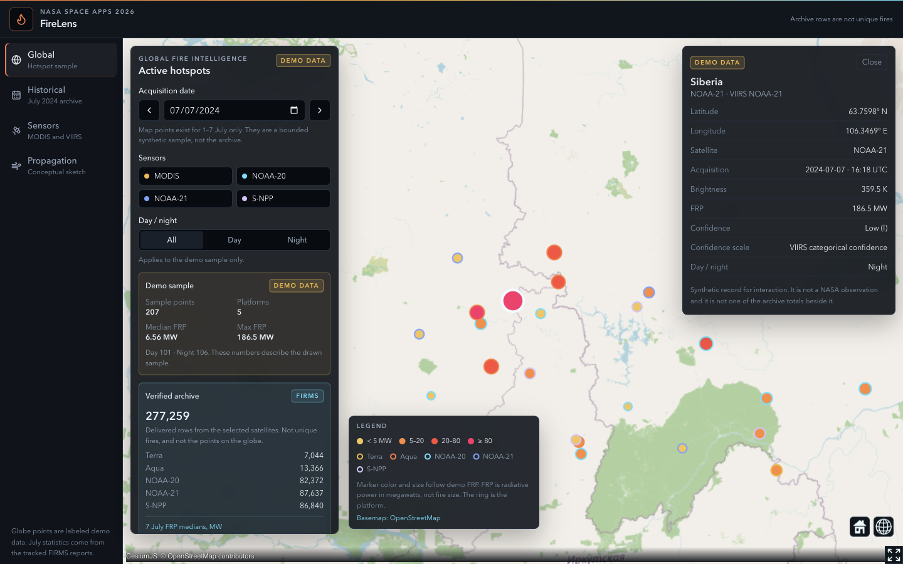
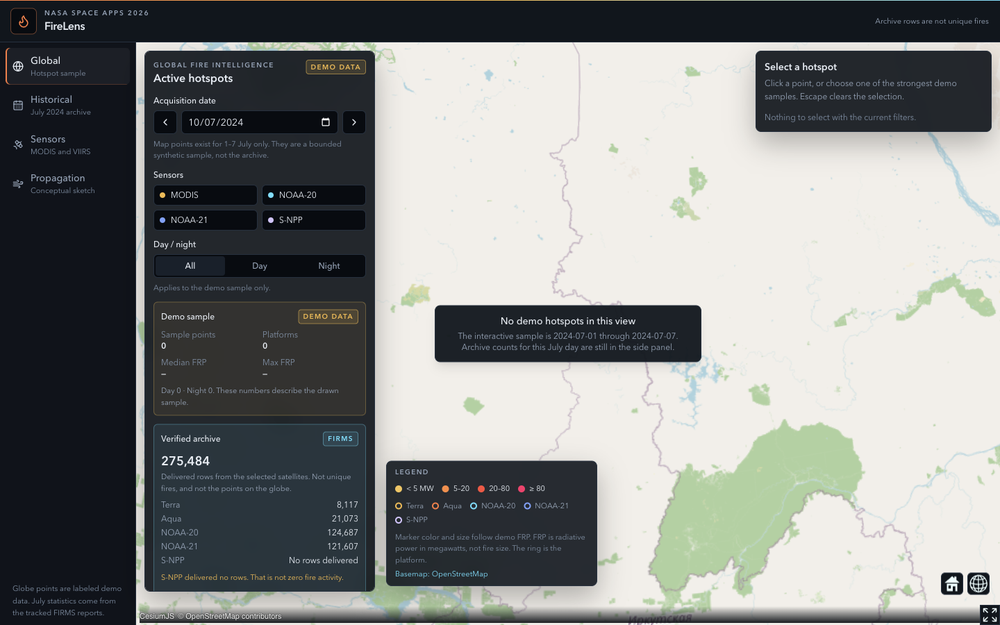
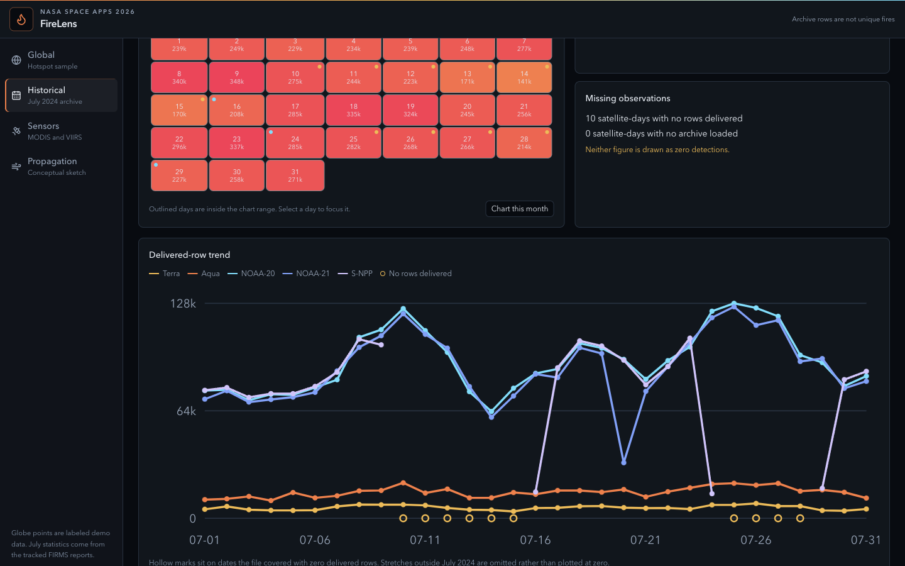
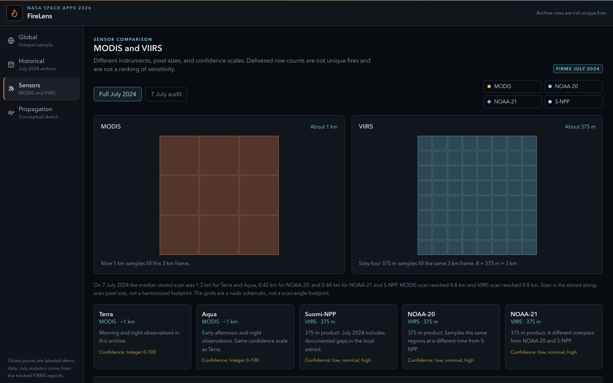
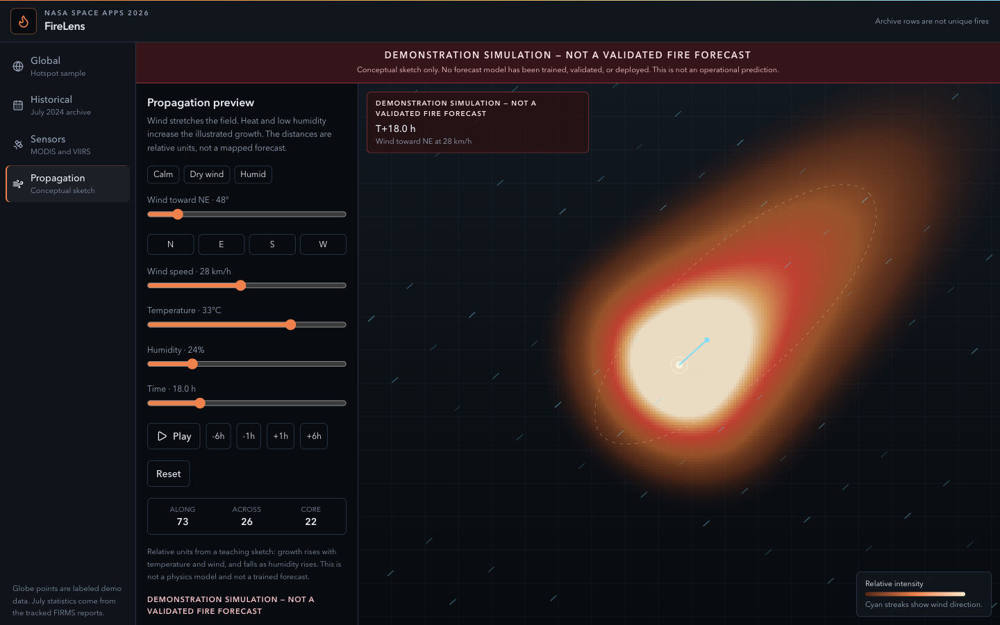

# FireLens

One planet. Multiple sensors. One consistent fire history.

FireLens is the NASA Space Apps Challenge 2026 demonstration for comparing MODIS and VIIRS active-fire observations. The interactive site shows how Terra, Aqua, Suomi-NPP, NOAA-20, and NOAA-21 describe the same month, and it keeps a bright line between verified archive statistics and a synthetic globe.

A validated historical harmonization coefficient is not claimed. The scientific record in this repository is a July 2024 audit of NASA FIRMS active-fire tables: what the files contain, how the sensors differ, and which comparisons are still only candidates.

| | |
| --- | --- |
| Demonstration | Four-screen FireLens site. Run it with Node.js. No NASA key and no raw archive are required. |
| Archive shown in the interface | July 2024 delivered-row statistics, transcribed from the tracked reports and checked in code. |
| Globe | 1,484 synthetic points for 1–7 July 2024. Illustrative positions, not FIRMS coordinates. |
| Science status | Descriptive audit and four bounded experiments. `same_fire` remains `not_assessed`. XGBoost is not trained. |

Further reading: [architecture](docs/ARCHITECTURE.md), [data and scientific limitations](docs/DATA_AND_LIMITATIONS.md), and the [screenshot inventory](docs/screenshots/README.md).

## Project overview

Wildfire monitoring already has more than one global satellite record. MODIS, on Terra and Aqua, and VIIRS, on Suomi-NPP, NOAA-20, and NOAA-21, all publish active-fire detections through NASA's Fire Information for Resource Management System (FIRMS). A researcher who wants one history has to decide when a difference is the fire and when it is the instrument.

FireLens is built for that decision. The site has four screens:

- **Global Fire Intelligence** places a labeled synthetic sample on a CesiumJS globe and, beside it, the verified July delivered-row counts.
- **Historical Fire Explorer** charts the July 2024 archive by day and satellite. Dates with no delivered rows stay blank.
- **Sensor Comparison** keeps MODIS and VIIRS on their own confidence scales, pixel sizes, and FRP summaries.
- **Fire Propagation Preview** is a conceptual wind-and-weather sketch. The screen states that it is not a validated forecast.

The Python package in `backend/fire_data` is a separate scientific workflow. It reads local FIRMS CSV extracts and writes the reports under `backend/reports/` and `backend/experiments/`. The website does not call that package, and it does not call NASA.

Three ideas stay separate throughout the project:

- A **detection** is one archived row: one sensor, one stored location, one acquisition minute.
- A **candidate pair** is two detections inside a stated distance and time window. It is evidence of nearness.
- A **physical fire** is a real burning event. Identifying one requires more than a nearby pair, and this repository does not make that identification.

Fire radiative power (FRP) is the stored radiant power of a detected hot spot, in megawatts. It is the measurement a later calibration could compare. No calibration coefficient is fit here.

## The scientific challenge

A consistent multi-sensor fire history has to answer a narrow question. When two satellites report hot spots in the same region, how much of the difference is fire activity, and how much is the instrument, the pixel footprint, the overpass time, or the processing stream?

July 2024 is the month this repository can actually describe. The tracked extracts contain:

- **7,985,467** delivered observations for 1–31 July 2024, across Terra, Aqua, Suomi-NPP, NOAA-20, and NOAA-21.
- **277,259** delivered observations on 7 July 2024. The same five counts appear both in the separate one-day sample and on that date inside the monthly files. The monthly exploratory report records a difference of zero for each satellite.

Those numbers are archive rows. They are not a count of unique fires, and they are not a ranking of which sensor is more sensitive.

The work completed against those files is descriptive and diagnostic:

- Inventory of columns, satellites, instruments, versions, confidence codes, and acquisition dates.
- A provenance review that leaves the processing stream of each local file unresolved.
- Exploratory summaries of FRP, brightness, confidence, day/night, and stored pixel size, for 7 July and for the full month.
- An investigation of VIIRS brightness stored at 367 K, and of two extreme Aqua FRP rows on 7 July.
- Spatial-temporal candidate pairs, nearest neighbors, and within-sensor analytical clusters. Each report states that these are not confirmed fires.
- Four experiments (clustering stability, measurement distributions, overpass timing, and resolution proxies) run on the same July input. Each one records `harmonization_coefficient: null` and `xgboost_trained: false`.

The design for a later multi-year sample is written down in `backend/research/`. No file for that sample was downloaded. July 2024 is excluded from the proposed training, calibration, and validation periods so the month already studied is not reused as if it were new.

## Why MODIS and VIIRS harmonization matters

Counts from one sensor cannot be subtracted from counts from another and called a change in fire activity. The five platforms in this project are not interchangeable.

| Platform | Sensor in these files | What differs |
| --- | --- | --- |
| Terra | MODIS | Morning and night observations. Confidence is an integer from 0 to 100. Nominal pixel class is about 1 km. |
| Aqua | MODIS | Early-afternoon and night observations. Same confidence scale as Terra. A different orbit and a different row count. |
| Suomi-NPP | VIIRS 375 m | Confidence is `l`, `n`, or `h`. The July extract has multi-day gaps. |
| NOAA-20 (JPSS-1) | VIIRS 375 m | Same VIIRS confidence flags and a different overpass time. |
| NOAA-21 (JPSS-2) | VIIRS 375 m | Same table shape as NOAA-20. On this month, NOAA-20 and NOAA-21 candidate pairs inside 30 minutes are absent at the published radii, while pairs inside 60 minutes are common. |

Harmonization matters because a long fire history will cross these instruments. Terra and Aqua MODIS and the VIIRS series do not share a pixel, a confidence scale, or, in this repository, a demonstrated processing stream. Until those differences are measured and a coefficient is fit on data held out from this month, a combined count would mix the sensor into the fire.

The practical consequences already visible in the July tables:

- **Detections are not fires.** One burning area can produce many pixels and can be seen again on a later overpass.
- **Confidence scales differ.** A MODIS value of 75 and a VIIRS flag of `h` are different quantities. The interface never converts one into the other.
- **Brightness is not one temperature.** VIIRS `brightness` in these CSVs reaches an exact stored maximum of 367 K. MODIS brightness is a different stored temperature and, in the July archive, exceeds 367 K.
- **FRP retrievals differ by sensor.** The unit is megawatts in every file. The algorithm, the pixel size, and the behavior at high brightness are not the same. A ratio of two positive FRP values, where one is published, is a description of a candidate sample. It is not a coefficient.
- **Pixel geometry changes with scan position.** `scan` and `track` are stored along-scan and along-track sizes in kilometres. A 1 km search radius is not a sensor footprint.
- **Missing rows are not zero fire activity.** Suomi-NPP has ten July dates with no delivered rows. Those dates are omitted from comparison denominators. They are not filled from another satellite.

## NASA satellite data sources

The analysis uses FIRMS active-fire CSV extracts. The product codes requested for this project are:

| Code | Product family used here | Satellites in the file |
| --- | --- | --- |
| `M-C61` | MODIS Collection 6.1 fire locations | Terra and Aqua, kept separate after the file is read |
| `SV-C2` | VIIRS 375 m Suomi-NPP | Suomi-NPP. The file stores `satellite` and `instrument` as `SNPP`. |
| `J1V-C2` | VIIRS 375 m NOAA-20 | NOAA-20, stored as `N20` |
| `J2V-C2` | VIIRS 375 m NOAA-21 | NOAA-21, stored as `N21` |

Download tables from the [FIRMS archive download](https://firms.modaps.eosdis.nasa.gov/download/). The current code does not call the FIRMS area API and does not contain a FIRMS `MAP_KEY`.

Every analyzed file uses this header:

`latitude,longitude,brightness,scan,track,acq_date,acq_time,satellite,instrument,confidence,version,bright_t31,frp,daynight,type`

`acq_date` and `acq_time` are UTC. `acq_time` is `HHMM`. The files have no seconds. MODIS version text in these extracts is `61.03`. VIIRS version text is `2`. Those strings are stored. They are not used to assign near-real-time or standard processing.

Two local orders exist, and they are different files:

- A **7 July 2024 sample** under `backend/data/raw/`, request ids 850118–850121.
- A **1–31 July 2024 extract** under `backend/data/raw/monthly_2024_07/`, request ids 850319–850322.

Both orders are gitignored. The reports that describe them are tracked. Paths and the rule against committing CSVs or keys are in [`backend/data/raw/README.md`](backend/data/raw/README.md).

The FIRMS download readme defines `fire_archive_M-C61` and `fire_archive_SV-C2`, and it says standard-quality data are not yet available from FIRMS for NOAA-20 and NOAA-21. The FIRMS API availability catalog lists standard-processing sensor codes for both NOAA-20 and NOAA-21. The CSVs store neither the readme short names nor the API sensor codes. The project therefore leaves `processing_stream` unresolved for every local archive, including the files whose names the readme does define. That decision is recorded in [`backend/reports/data_readiness.md`](backend/reports/data_readiness.md) and [`backend/research/HISTORICAL_DATA_STRATEGY.md`](backend/research/HISTORICAL_DATA_STRATEGY.md).

## FireLens features

The interface is a React single-page application. Navigation is local. Nothing on these screens requests a satellite product at runtime.

### Global Fire Intelligence

The globe screen is the default view. CesiumJS draws the Earth. Marker color and size follow the demo FRP scale. The ring color is the platform: Terra, Aqua, NOAA-20, NOAA-21, or Suomi-NPP.

What a reviewer can do:

- Step through 1–31 July 2024.
- Filter the drawn sample by sensor and by the demo day/night flag.
- Select a point and read its synthetic brightness, FRP, confidence, and illustrative cluster name.
- Return to a world view.

The map points exist only for 1–7 July. The side panel keeps two labeled blocks. **Demo sample** counts the points on screen. **Verified archive** shows the delivered-row total for the selected July date and the selected satellites. On 7 July it also shows the audited FRP medians. On every other July date it shows counts only, because daily FRP was not published for those dates. The panel states that the archive total is not the points on the globe.

Without a Cesium ion token the basemap is OpenStreetMap imagery on the WGS84 ellipsoid. With a token, the viewer uses Cesium ion imagery and Cesium World Terrain. The legend names whichever basemap is active.

### Historical Fire Explorer

This screen reads the transcribed July 2024 delivery table.

- Choose a date range and a set of satellites. Terra and Aqua stay separate inside MODIS.
- A calendar of the selected month shades delivered activity. Days with no delivered rows are marked as gaps. Months other than July 2024 have no loaded archive, and those days are not filled with zeros.
- A trend chart plots delivered rows. Hollow marks are dates the file covered with zero delivered rows. Dates outside the July extract are omitted from the line.
- Early July (1–15) is set beside late July (16–31), with a gap-day count, so the Suomi-NPP gaps are visible as incomplete delivery.
- Monthly FRP median and maximum are shown for the full month. They do not change with the date range.
- Coverage notes quote the tracked Suomi-NPP and NOAA-21 caveats.
- **Export CSV** writes the filtered delivered-row table: date, satellite, count, status, and note. It does not export raw detections, and it does not export the synthetic globe points.

### Sensor Comparison

The comparison screen is a reading of instrument differences, for the full month or for the 7 July audit.

- A nadir schematic places a 3 km frame beside itself: nine ~1 km MODIS samples, and sixty-four ~375 m VIIRS samples. The caption in the interface says this grid is not a scan-angle footprint.
- Five platform cards state the sensor, the nominal resolution, and the confidence vocabulary.
- Delivered-row bars show archive volume. The caption says adding sensors does not count fires.
- FRP median, 95th percentile, 99th percentile, and maximum sit on a log scale from 0.5 MW to 12,000 MW. The ticks are stored-value summaries, not a histogram and not fire size.
- MODIS confidence stays an integer from 0 to 100. VIIRS confidence stays the flags low, nominal, and high.
- Day and night use the stored `daynight` flag. The flag is not recomputed from local solar time.

On 7 July the screen reports MODIS confidence medians and does not repeat the month's counts of confidence 0 and 100, because those single-day tallies are not the figures transcribed onto that control.

### Fire Propagation Preview

The propagation screen is a canvas sketch. Wind direction, wind speed, temperature, and humidity change the illustrated shape over a 0–72 hour control. Three presets (Calm, Dry wind, Humid) set those inputs. Distances are relative units inside the drawing.

A persistent banner reads: **DEMONSTRATION SIMULATION — NOT A VALIDATED FIRE FORECAST.** The screen also states that no forecast model has been trained, validated, or deployed. The sketch does not ingest FIRMS rows, does not use the July experiments, and does not call XGBoost. XGBoost is not a dependency of this repository.

## Architecture overview

FireLens is two codebases that meet only through checked documents.

```text
Browser                         Repository                         Optional local science
React + Vite + CesiumJS         Transcribed July statistics        Python fire_data
Four screens                    Tracked reports and figures        Gitignored FIRMS CSVs
No NASA requests                No credentials                     No HTTP API
```

The frontend data layer lives in `src/data/`. `demoHotspots.ts` builds the 1,484-point sample with a fixed random seed. `archiveJuly2024.ts` holds the July delivery counts and the FRP, confidence, and day/night portraits. On load it checks that the daily series sum to the monthly totals, that 7 July sums to 277,259, and that day/night and VIIRS confidence flags sum to each satellite's row count.

There is no server between the website and the Python package. Regenerating a report requires the local CSVs. Reading a report does not.

The full component map, the ingestion path, and the report index are in [docs/ARCHITECTURE.md](docs/ARCHITECTURE.md).

## Technology stack

**Frontend, installed and used**

| Piece | Role |
| --- | --- |
| React 19 and React DOM | Interface |
| TypeScript 7 | Typed source, including the archive transcription |
| Vite 8 | Development server and production build |
| Tailwind CSS 4 | Styling |
| CesiumJS 1 | Globe. Workers and assets are copied to `/cesiumStatic`. |
| Lucide React | Icons |
| Oxlint | `npm run lint` |

**Scientific backend, optional**

| Piece | Role |
| --- | --- |
| Python 3.11 or newer | Local analyses |
| pytest, NumPy, SciPy, Matplotlib | Pinned in [`backend/requirements.txt`](backend/requirements.txt) |
| pypdf | Used when a retrieved user's guide is read as a local PDF |

**Not in this repository**

- No Firebase SDK, service account, or Firestore rules.
- No XGBoost installation and no trained model file.
- No Parquet or GeoParquet tables.
- No public HTTP API.
- Three.js is not a dependency. CesiumJS is the globe.

## Dataset description and provenance

### July 2024 monthly archive

Source: four FIRMS ZIP archives ingested into `backend/data/raw/monthly_2024_07/`. The ingestion manifest passed. Each extracted CSV checksum matches that manifest. Exact duplicate rows retained: 0. Extra location-time keys retained: 5 (1 in NOAA-20, 4 in NOAA-21). No row was removed.

| Archive | File | Delivered rows | SHA-256 |
| --- | --- | ---: | --- |
| MODIS C6.1 | `fire_archive_M-C61_850319.csv` | 676,636 | `97e1a4312fbe488e63fd06461865b21dd5d01c419f2e80fa6e178c0015f10c81` |
| VIIRS S-NPP | `fire_archive_SV-C2_850322.csv` | 1,635,020 | `bc5ff311c2df9113baf4eedaf4247d55954e8f4fa2ca052f940a943365314f21` |
| VIIRS NOAA-20 | `fire_archive_J1V-C2_850320.csv` | 2,902,597 | `9a192db30e307c257955047ca1177e3f2f463b8c8cdfda7b28ceac6b3aa92bd5` |
| VIIRS NOAA-21 | `fire_archive_J2V-C2_850321.csv` | 2,771,214 | `c86e46d4ca730eea6db448ff928126ddc6b44ba4c4d11dfbc3a2d999f4937007` |
| **Five platforms** | Terra 195,316 and Aqua 481,320 are the MODIS split | **7,985,467** | Difference from the reference total: 0 |

Authority: [`backend/reports/temporal_coverage_2024_07.md`](backend/reports/temporal_coverage_2024_07.md) and [`backend/research/SHARED_DATA_CONTRACT.md`](backend/research/SHARED_DATA_CONTRACT.md).

| Satellite | Delivered rows | Dates with rows | Dates with no rows |
| --- | ---: | ---: | ---: |
| Terra | 195,316 | 31 | 0 |
| Aqua | 481,320 | 31 | 0 |
| NOAA-20 | 2,902,597 | 31 | 0 |
| NOAA-21 | 2,771,214 | 31 | 0 |
| Suomi-NPP | 1,635,020 | 21 | 10 |

Suomi-NPP dates with no delivered rows: 10–15 July and 25–28 July 2024. Partial delivery, rows present for only part of the UTC day: 16 July (15,643 rows after 17:42 UTC), 24 July (14,621 rows before 05:28 UTC), and 29 July (17,802 rows after 15:24 UTC). NOAA-21 on 20 July delivered 33,039 rows and has no rows in UTC hours 08–13. That hour gap is not labeled an outage.

### 7 July 2024 sample

A separate four-file sample, acquisition date 2024-07-07 only:

| Archive | File | Rows |
| --- | --- | ---: |
| MODIS | `fire_archive_M-C61_850118.csv` | 20,410 (Terra 7,044, Aqua 13,366) |
| VIIRS NOAA-20 | `fire_archive_J1V-C2_850119.csv` | 82,372 |
| VIIRS NOAA-21 | `fire_archive_J2V-C2_850120.csv` | 87,637 |
| VIIRS S-NPP | `fire_archive_SV-C2_850121.csv` | 86,840 |
| **Total** | | **277,259** |

The one-day exploratory report, anomaly investigation, temporal audit, and readiness review describe this sample. The monthly files reproduce the same five row counts on 7 July.

### What the audit measured

The measurements below are copied from the tracked reports. They describe stored rows.

- July FRP medians: Terra 19.1 MW, Aqua 21.6 MW, Suomi-NPP 5.06 MW, NOAA-20 5.14 MW, NOAA-21 6.09 MW. Extremes are retained. Aqua's July maximum is 10,950 MW. Zero-FRP rows are kept in the distributions (Terra 393, Aqua 155, NOAA-20 809, NOAA-21 1,710, Suomi-NPP 373).
- On 7 July, VIIRS brightness reaches exactly 367 K and no higher: NOAA-20 3,190 rows (3.87%), NOAA-21 7,305 (8.34%), Suomi-NPP 5,600 (6.45%). No row falls in the open interval from 360 K to 367 K. The full-month VIIRS archives show the same ceiling. The CSVs have no Level-1 saturation flag, so 367 K is not marked as confirmed saturation of an individual row. The Collection 2 user's guide describes 367 K as the nominal I-4 saturation assignment in the typical case.
- At 1 km and 30 minutes, NOAA-20 and NOAA-21 have zero candidate pairs. At 5 km and 60 minutes their median time difference falls in the 50–51 minute bin. An empty 30-minute window for that pair is a statement about acquisition time, not a statement that the rows are far apart on the ground.
- Within-sensor DBSCAN at 1 km, 30 minutes, and `min_samples` 4 leaves most MODIS rows as noise (Terra 98.2%, Aqua 98.9%) and a smaller VIIRS noise share (Suomi-NPP 44.4%, NOAA-20 46.3%, NOAA-21 47.0%). A component is an analytical label. It is not a confirmed fire.

Detail, caveats, and the pair tables are in [docs/DATA_AND_LIMITATIONS.md](docs/DATA_AND_LIMITATIONS.md).

## Real data versus synthetic demonstration data

The interface shows both kinds of number, and it labels them.

| Surface | Data | Source label in the UI |
| --- | --- | --- |
| Globe markers | 1,484 synthetic points, 1–7 July 2024. Every record has `source: 'demo'`. Positions come from a seeded generator and named illustrative clusters. They are not archived latitudes and longitudes. | Demo data |
| Globe side panel, "Verified archive" | Delivered-row counts for the selected July date, plus 7 July FRP medians | FIRMS |
| Historical explorer and sensor comparison | July aggregates: daily counts, monthly and 7 July FRP, confidence, day/night, scan note | FIRMS July 2024 |
| CSV export | The same delivered-row table | Column `source` names the archive, or states that no archive is loaded |
| Propagation preview | An internal sketch. No satellite rows. | Demonstration simulation |

The daily counts inside the synthetic sample, from the generator in `src/data/demoHotspots.ts`, are 205, 208, 210, 223, 216, 215, and 207 for 1–7 July. Those are demo points. The archive delivered hundreds of thousands of rows on each of those dates.

A date with no delivered rows is stored as null in the transcription and rendered as "No rows delivered." A month with no loaded archive is omitted from the trend. Neither case is drawn as zero fires.

## Scientific limitations

These limits are part of the result. They are written so a reviewer does not promote a diagnostic into a product claim.

- The project does not claim a validated historical harmonization coefficient. Experiment manifests store `harmonization_coefficient` as null.
- The propagation screen is conceptual. It is not a validated wildfire forecast, and it is not an operational prediction.
- XGBoost is not trained and is not deployed. Training it is rejected by the experiment contract.
- A missing satellite observation must not be interpreted as zero fire activity. `zero_rows_delivered` means the CSV is present and has no row with that acquisition date.
- Satellite detections are not unique fires. Pair counts, nearest-neighbor matches, and cluster counts are not fire counts.
- `same_fire` is `not_assessed` on the experiment configurations and on the July reports that state the field.
- Processing level remains unresolved for the local NOAA-20 and NOAA-21 files, and the project also declines to infer it for the MODIS and Suomi-NPP files from the filename prefix or the version column.
- VIIRS rows at 367 K are an observed stored value. They are not individually confirmed saturated pixels.
- July 2024 is a locked descriptive month. The sampling strategy excludes it from training, calibration, and validation.
- The globe coordinates are synthetic. They must not be cited as NASA fire locations.
- FIRMS active-fire products are research and situational-awareness inputs. This demonstration does not turn them into a tactical decision tool.

The open questions and the evidence behind each limit are collected in [docs/DATA_AND_LIMITATIONS.md](docs/DATA_AND_LIMITATIONS.md).

## Installation and local execution

The website runs from the tracked source and the npm dependencies. It does not need the FIRMS CSVs, a FIRMS map key, or a Cesium ion token.

### Frontend

Vite 8 requires Node.js `^20.19.0` or `>=22.12.0`. These instructions were checked in this workspace with Node.js 23.11.0 and npm 10.9.2.

```bash
npm install
npm run dev
```

Vite prints a local URL, usually `http://localhost:5173`. Open it and use the four screens: Global, Historical, Sensors, and Propagation.

Optional Cesium ion imagery and terrain:

```bash
cp .env.example .env
```

Set `VITE_CESIUM_ION_TOKEN` in `.env` only. Leave it empty to keep OpenStreetMap and the WGS84 ellipsoid. `.env` is gitignored. [`.env.example`](.env.example) contains an empty placeholder. Create a token at [ion.cesium.com/tokens](https://ion.cesium.com/tokens) if you want the ion basemap. Restart the dev server after changing `.env`.

OpenStreetMap tiles used in development must follow the [OpenStreetMap tile usage policy](https://operations.osmfoundation.org/policies/tiles/).

Checks:

```bash
npm run lint
npm run build
npm run preview
```

`npm run lint` runs Oxlint. `npm run build` runs the TypeScript project build, then the Vite production bundle. `npm run preview` serves that bundle.

### Optional scientific workflow

From `backend/`, with Python 3.11 or newer:

```bash
python3 -m venv .venv
.venv/bin/python -m pip install -r requirements.txt
.venv/bin/python -m pytest
```

On Windows, use `.venv\Scripts\python`.

Discovery, validation, the one-day summaries, ingestion, and the July analyses read CSVs under `backend/data/raw/`. Those files are not in git. Without them, the report generators that open the archives cannot reproduce the committed numbers. The reports themselves can be read immediately.

Commands that the backend documents, once the matching local files are present:

```bash
.venv/bin/python -m fire_data discover
.venv/bin/python -m fire_data validate
.venv/bin/python -m fire_data eda
.venv/bin/python -m fire_data.investigate
.venv/bin/python -m fire_data.temporal
.venv/bin/python -m fire_data.readiness
.venv/bin/python -m fire_data.ingest --dry-run
```

`validate` exits with status 1 when an archive fails the observed column contract. `ingest` reads four unmodified ZIPs from `backend/data/incoming/2024-07/` and does not write into the 7 July sample directories. Later modules (`within_sensor_analysis`, `spatiotemporal_analysis`, `nearest_neighbor_analysis`, `monthly`, and `python -m fire_data.experiments`) are the workflows that produced the July reports and experiments. They are not required to use the website. The package README is [`backend/README.md`](backend/README.md).

## Screenshots

These five frames were captured from the running FireLens application at 1440×900. The inventory, including which frames show synthetic points, is in [`docs/screenshots/README.md`](docs/screenshots/README.md).











Plots under `backend/reports/figures/` and `backend/experiments/` are scientific figures from the July analyses. They are not pictures of the FireLens interface.

## Future roadmap

The order below follows the written strategy. A later step waits until the earlier evidence exists.

1. **Name the processing stream before any coefficient.** A stream is assigned only when provider metadata, or a product document that defines that exact file, names it. The filename prefix and the version text stay text.
2. **Acquire the historical sample as a new order.** The plan in [`backend/research/ACQUISITION_PLAN.md`](backend/research/ACQUISITION_PLAN.md) uses a new directory and does not overwrite the July request ids. No order was submitted for that sample.
3. **Keep July 2024 descriptive.** The validation calendar in [`backend/research/VALIDATION_SAMPLING_STRATEGY.md`](backend/research/VALIDATION_SAMPLING_STRATEGY.md) excludes the whole month from training, calibration, and validation.
4. **Leave gaps empty.** Suomi-NPP dates with no rows stay out of denominators. They are not repaired from NOAA-20, NOAA-21, Terra, or Aqua.
5. **Decide a harmonization design only after that sample exists.** FRP is the candidate measurement. `scan` and `track` are geometry. Day/night and satellite are strata. Brightness and confidence stay on their native scales until the quality metadata supports a shared use.
6. **Replace the synthetic globe** with verified detection coordinates, still labeled as detections rather than as unique fires.
7. **Leave forecasting unauthorized** until a model is trained and validated on held-out data. XGBoost is not that model today. The propagation screen remains a sketch.

Also unresolved, and not scheduled as a silent default: an H3 resolution is not selected; Terra and Aqua are not pooled without an explicit pair label; and no license file has been added.

## Acknowledgments and references

The public repository is [larzzondev/nasa-space-apps-2026-fire-modis-viirs-harmonization](https://github.com/Larzzondev/nasa-space-apps-2026-fire-modis-viirs-harmonization). This file does not invent a contributor list. Names belong here when the people who did the work add them.

Data and documents used in the audit:

- NASA FIRMS and LANCE, including the [archive download](https://firms.modaps.eosdis.nasa.gov/download/) and the [download readme](https://firms.modaps.eosdis.nasa.gov/download/Readme.txt).
- FIRMS attribute descriptions for [VIIRS](https://firms.modaps.eosdis.nasa.gov/content/descriptions/FIRMS_VIIRS_Firehotspots.html) and [MODIS](https://firms.modaps.eosdis.nasa.gov/content/descriptions/FIRMS_MODIS_Firehotspots.html), and the [Earthdata active-fire attribute page](https://www.earthdata.nasa.gov/data/tools/firms/active-fire-data-attributes-modis-viirs).
- FIRMS [API data-availability](https://firms.modaps.eosdis.nasa.gov/api/data_availability/) catalog, used as a document. It was not queried with a map key for the July science runs.
- Schroeder, Giglio, and Hall, Collection 2 VIIRS 375 m Active Fire Product User's Guide, version 1.2, June 2025: [VIIRS_C2_AF-375m_User_Guide_1.2.pdf](https://www.earthdata.nasa.gov/s3fs-public/2025-06/VIIRS_C2_AF-375m_User_Guide_1.2.pdf).
- LP DAAC alerts for the July 2024 Suomi-NPP VIIRS [geolocation anomaly](https://www.earthdata.nasa.gov/data/alerts-outages/suomi-npp-viirs-data-product-geolocation-anomaly-july-2024) and the [24 July anomaly](https://www.earthdata.nasa.gov/data/alerts-outages/suomi-npp-viirs-data-product-anomaly-july-2024).
- Active-fire science products acknowledged in those guides are produced with the University of Maryland and distributed by FIRMS.

Software: [CesiumJS](https://cesium.com/platform/cesiumjs/) for the globe. [OpenStreetMap](https://www.openstreetmap.org/copyright) contributors for the default development imagery.

**License.** No license file is in the repository yet. Apache-2.0 is a suitable permissive license for this scientific software, including its patent grant, once the copyright holders confirm that choice. Third-party data, Cesium ion services, and OpenStreetMap tiles keep their own terms.
