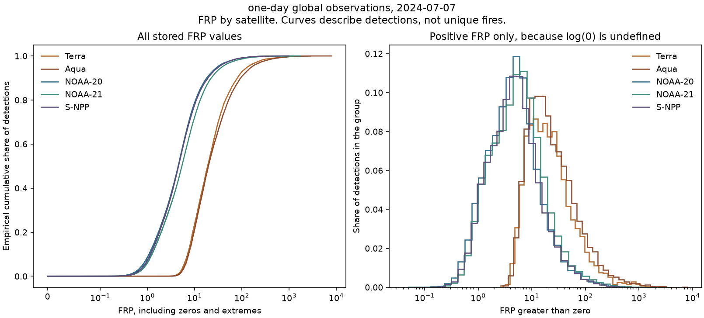
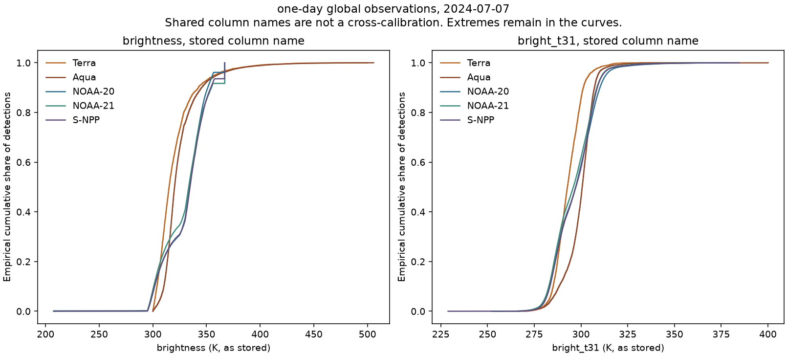
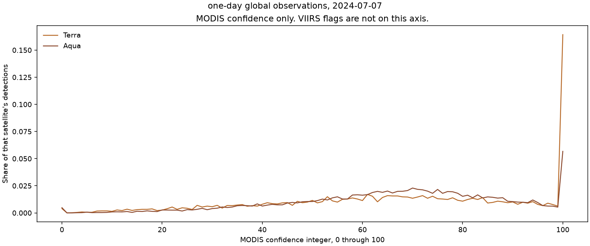
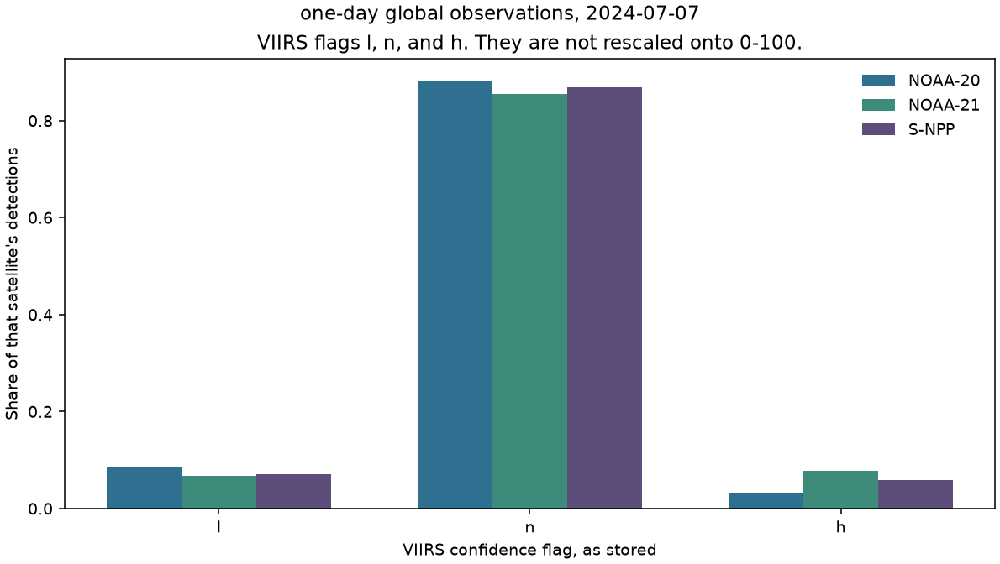
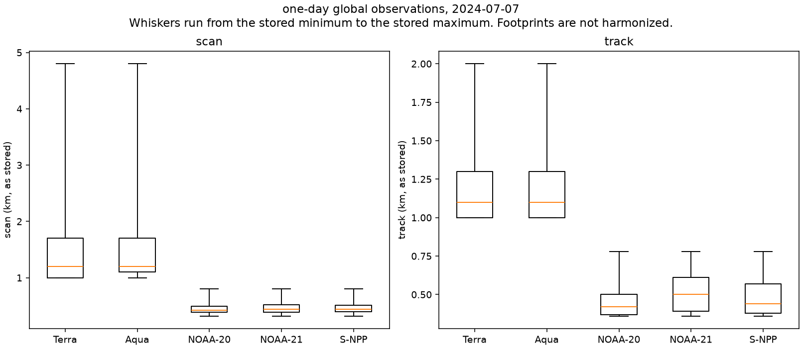
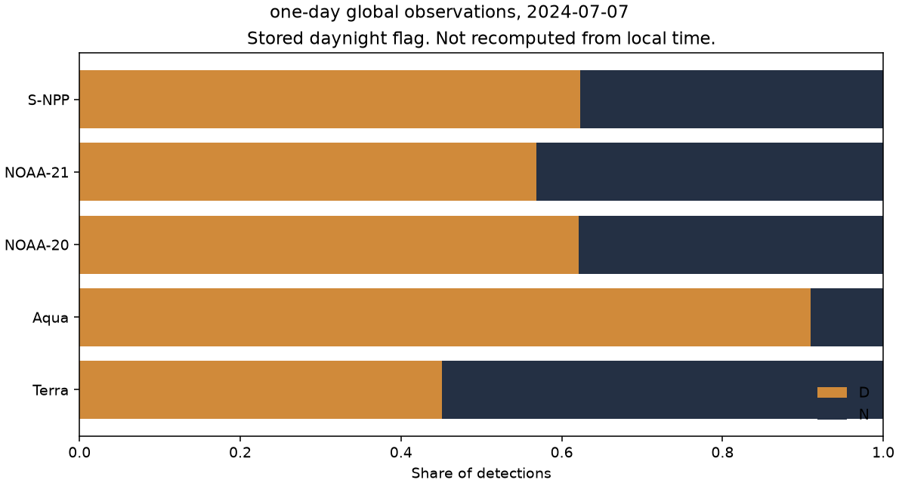
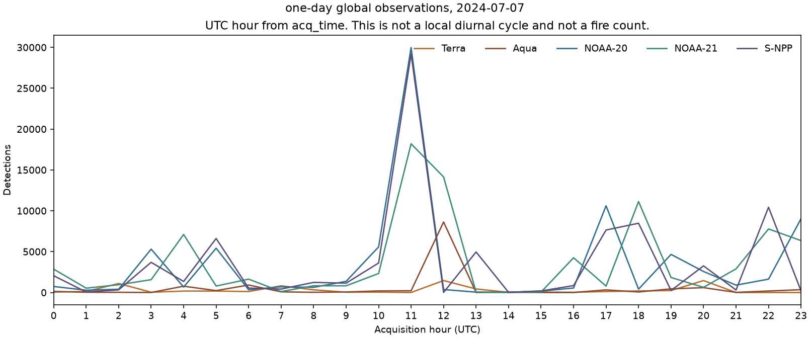
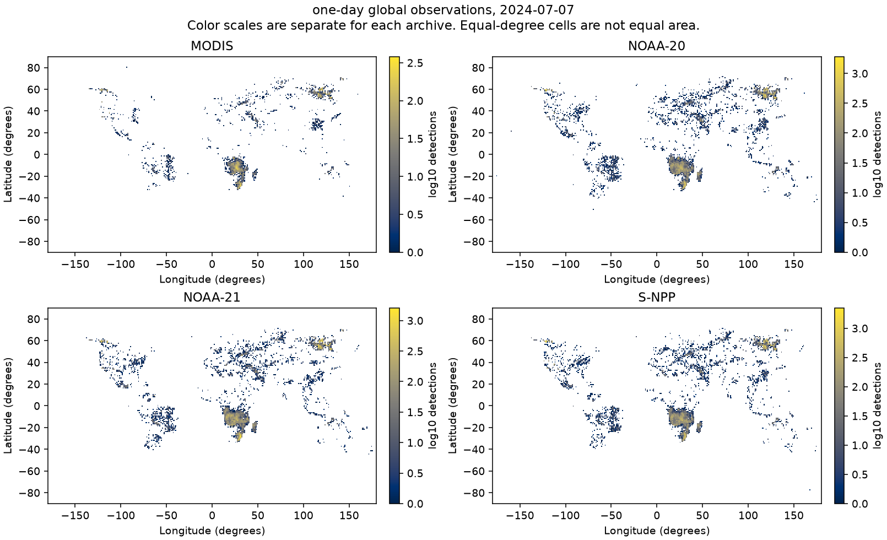
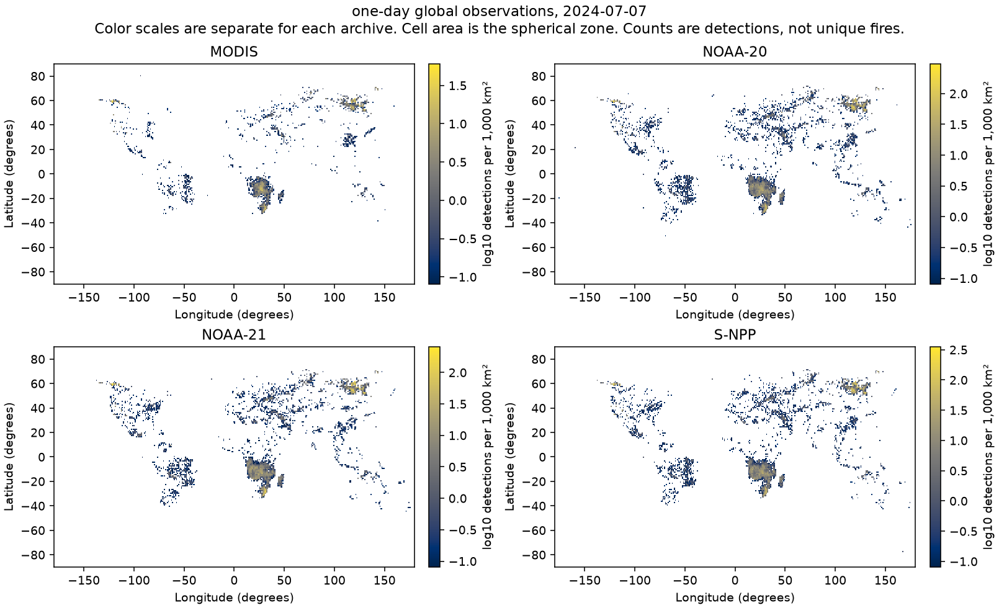
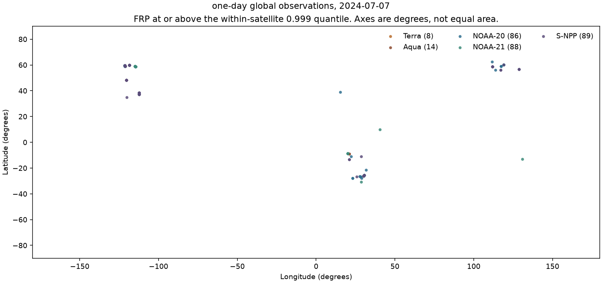

# Exploratory summary of FIRMS active-fire detections

**Scope:** one-day global observations for 2024-07-07.

This report describes 277,259 archived detections in the extracted FIRMS standard-processing files. Detections are not unique fires. No harmonization factor is calculated.

## Limits

- All figures and statistics are one-day global observations from the extracted FIRMS archives.
- Detections are not unique fires.
- No harmonization factor is calculated.
- Confidence scales are not equivalent.
- Extreme FRP values are retained.
- Raw detection counts are not a measure of sensor quality.
- This date does not support a seasonal or historical conclusion.
- The raw CSV files are not modified.

Satellite groups partition each source. Source totals are the archive row counts. Adding a source total to its satellite totals double counts the same detections.

## Populations

| Group | Archive | Detections | Distinct UTC timestamps |
| --- | --- | ---: | ---: |
| MODIS archive | `modis/fire_archive_M-C61_850118.csv` | 20,410 | 393 |
| Terra | `modis/fire_archive_M-C61_850118.csv` | 7,044 | 220 |
| Aqua | `modis/fire_archive_M-C61_850118.csv` | 13,366 | 215 |
| NOAA-20 archive | `viirs_noaa20/fire_archive_J1V-C2_850119.csv` | 82,372 | 428 |
| NOAA-21 archive | `viirs_noaa21/fire_archive_J2V-C2_850120.csv` | 87,637 | 448 |
| S-NPP archive | `viirs_snpp/fire_archive_SV-C2_850121.csv` | 86,840 | 446 |

## FRP

Sample standard deviation with divisor n-1. Null when a group has fewer than two detections. numpy.quantile method=linear. Count of values exactly equal to 0. Zeros remain in the mean, the quantiles, and the extrema. Within each satellite, FRP at or above the 0.999 quantile is flagged, including ties. Flagged rows remain in every distribution. The flag is an investigation list, not a filter.

The mean and standard deviation respond strongly to the retained high values. The median and upper quantiles describe the rest of the stored distribution. Differences among satellites are descriptive for this date. Raw detection counts are not a measure of sensor quality.

| Group | Count | Mean | Median | Std | P95 | P99 | Maximum | Zero count |
| --- | ---: | ---: | ---: | ---: | ---: | ---: | ---: | ---: |
| Terra | 7,044 | 42.7793 | 18.9 | 110.8657 | 131.2 | 460.911 | 2901.5 | 4 |
| Aqua | 13,366 | 50.6342 | 19.5 | 158.1605 | 160.6 | 543.07 | 7956.3 | 3 |
| MODIS archive (Terra + Aqua) | 20,410 | 47.9233 | 19.3 | 143.6547 | 151.41 | 520.591 | 7956.3 | 7 |
| NOAA-20 | 82,372 | 9.2702 | 4.47 | 20.9041 | 30.1 | 92.105 | 1168.99 | 18 |
| NOAA-21 | 87,637 | 11.8105 | 5.37 | 30.3956 | 37.93 | 120.9864 | 1740.42 | 66 |
| S-NPP | 86,840 | 9.6066 | 4.55 | 21.4741 | 32.24 | 91.17 | 974.25 | 29 |



*Empirical FRP distributions by satellite. The left panel includes zeros and extremes. The right panel uses a logarithmic axis, so zero FRP is omitted there and reported in the table.*

## Brightness and bright_t31

Both quantities use the column names stored in these files. A shared name is not a statement that the measurements have been cross-calibrated. VIIRS values are not renamed.

### Brightness

| Group | Count | Mean | Median | Std | P95 | P99 | Maximum | Zero count |
| --- | ---: | ---: | ---: | ---: | ---: | ---: | ---: | ---: |
| Terra | 7,044 | 320.492 | 315.1 | 19.5303 | 357.785 | 399.157 | 500 | 0 |
| Aqua | 13,366 | 325.2428 | 320.2 | 18.8312 | 359.7 | 403.5 | 505.7 | 0 |
| MODIS archive (Terra + Aqua) | 20,410 | 323.6032 | 318.9 | 19.2081 | 358.855 | 402 | 505.7 | 0 |
| NOAA-20 | 82,372 | 330.4934 | 334.34 | 18.4686 | 355.59 | 367 | 367 | 0 |
| NOAA-21 | 87,637 | 330.0599 | 333.4 | 20.6943 | 367 | 367 | 367 | 0 |
| S-NPP | 86,840 | 331.2385 | 334.61 | 19.6048 | 367 | 367 | 367 | 0 |

### bright_t31

| Group | Count | Mean | Median | Std | P95 | P99 | Maximum | Zero count |
| --- | ---: | ---: | ---: | ---: | ---: | ---: | ---: | ---: |
| Terra | 7,044 | 293.1845 | 292.8 | 7.0189 | 304.2 | 314.357 | 367.5 | 0 |
| Aqua | 13,366 | 299.481 | 300.6 | 8.086 | 309 | 317.4 | 400.1 | 0 |
| MODIS archive (Terra + Aqua) | 20,410 | 297.3079 | 298.2 | 8.2933 | 308.3 | 316.1 | 400.1 | 0 |
| NOAA-20 | 82,372 | 296.8767 | 297.15 | 11.4202 | 313.3 | 328.55 | 378.91 | 0 |
| NOAA-21 | 87,637 | 295.8222 | 295.9 | 10.8676 | 311.32 | 324.22 | 374.48 | 0 |
| S-NPP | 86,840 | 296.6535 | 297.25 | 10.8655 | 311.48 | 326.1561 | 384.53 | 0 |



*Brightness and bright_t31 by satellite, using the stored column names and retaining extremes.*

## Confidence

MODIS confidence is the stored integer from 0 through 100. VIIRS confidence is the stored flag `l`, `n`, or `h`. FIRMS documents those flags as low, nominal, and high. Those words name the flags. Confidence scales are not equivalent, and no value was converted from one scale to the other.

### MODIS Terra and Aqua

Terra median integer 69, Aqua median integer 69. The median is the median of the stored integers on the MODIS scale.

| Confidence | Terra count | Terra share | Aqua count | Aqua share |
| ---: | ---: | ---: | ---: | ---: |
| 0 | 28 | 0.40% | 64 | 0.48% |
| 2 | 1 | 0.01% | 0 | 0.00% |
| 3 | 3 | 0.04% | 2 | 0.01% |
| 4 | 6 | 0.09% | 3 | 0.02% |
| 5 | 4 | 0.06% | 9 | 0.07% |
| 6 | 4 | 0.06% | 3 | 0.02% |
| 7 | 12 | 0.17% | 4 | 0.03% |
| 8 | 13 | 0.18% | 4 | 0.03% |
| 9 | 13 | 0.18% | 6 | 0.04% |
| 10 | 10 | 0.14% | 12 | 0.09% |
| 11 | 19 | 0.27% | 13 | 0.10% |
| 12 | 15 | 0.21% | 12 | 0.09% |
| 13 | 24 | 0.34% | 17 | 0.13% |
| 14 | 16 | 0.23% | 6 | 0.04% |
| 15 | 21 | 0.30% | 20 | 0.15% |
| 16 | 23 | 0.33% | 17 | 0.13% |
| 17 | 23 | 0.33% | 25 | 0.19% |
| 18 | 26 | 0.37% | 19 | 0.14% |
| 19 | 15 | 0.21% | 16 | 0.12% |
| 20 | 18 | 0.26% | 36 | 0.27% |
| 21 | 27 | 0.38% | 35 | 0.26% |
| 22 | 38 | 0.54% | 34 | 0.25% |
| 23 | 23 | 0.33% | 34 | 0.25% |
| 24 | 33 | 0.47% | 23 | 0.17% |
| 25 | 30 | 0.43% | 40 | 0.30% |
| 26 | 22 | 0.31% | 36 | 0.27% |
| 27 | 49 | 0.70% | 44 | 0.33% |
| 28 | 38 | 0.54% | 56 | 0.42% |
| 29 | 44 | 0.62% | 39 | 0.29% |
| 30 | 40 | 0.57% | 53 | 0.40% |
| 31 | 49 | 0.70% | 58 | 0.43% |
| 32 | 31 | 0.44% | 73 | 0.55% |
| 33 | 48 | 0.68% | 66 | 0.49% |
| 34 | 47 | 0.67% | 72 | 0.54% |
| 35 | 51 | 0.72% | 88 | 0.66% |
| 36 | 54 | 0.77% | 91 | 0.68% |
| 37 | 43 | 0.61% | 89 | 0.67% |
| 38 | 47 | 0.67% | 84 | 0.63% |
| 39 | 44 | 0.62% | 111 | 0.83% |
| 40 | 56 | 0.80% | 84 | 0.63% |
| 41 | 66 | 0.94% | 96 | 0.72% |
| 42 | 60 | 0.85% | 105 | 0.79% |
| 43 | 58 | 0.82% | 99 | 0.74% |
| 44 | 65 | 0.92% | 99 | 0.74% |
| 45 | 67 | 0.95% | 121 | 0.91% |
| 46 | 49 | 0.70% | 129 | 0.97% |
| 47 | 75 | 1.06% | 123 | 0.92% |
| 48 | 66 | 0.94% | 137 | 1.02% |
| 49 | 70 | 0.99% | 140 | 1.05% |
| 50 | 81 | 1.15% | 140 | 1.05% |
| 51 | 65 | 0.92% | 151 | 1.13% |
| 52 | 73 | 1.04% | 170 | 1.27% |
| 53 | 105 | 1.49% | 159 | 1.19% |
| 54 | 78 | 1.11% | 185 | 1.38% |
| 55 | 70 | 0.99% | 198 | 1.48% |
| 56 | 88 | 1.25% | 171 | 1.28% |
| 57 | 90 | 1.28% | 170 | 1.27% |
| 58 | 97 | 1.38% | 220 | 1.65% |
| 59 | 90 | 1.28% | 223 | 1.67% |
| 60 | 80 | 1.14% | 218 | 1.63% |
| 61 | 120 | 1.70% | 225 | 1.68% |
| 62 | 108 | 1.53% | 251 | 1.88% |
| 63 | 72 | 1.02% | 265 | 1.98% |
| 64 | 100 | 1.42% | 253 | 1.89% |
| 65 | 112 | 1.59% | 269 | 2.01% |
| 66 | 110 | 1.56% | 245 | 1.83% |
| 67 | 110 | 1.56% | 265 | 1.98% |
| 68 | 104 | 1.48% | 266 | 1.99% |
| 69 | 103 | 1.46% | 275 | 2.06% |
| 70 | 95 | 1.35% | 306 | 2.29% |
| 71 | 103 | 1.46% | 290 | 2.17% |
| 72 | 112 | 1.59% | 284 | 2.12% |
| 73 | 95 | 1.35% | 268 | 2.01% |
| 74 | 108 | 1.53% | 241 | 1.80% |
| 75 | 92 | 1.31% | 289 | 2.16% |
| 76 | 90 | 1.28% | 241 | 1.80% |
| 77 | 87 | 1.24% | 263 | 1.97% |
| 78 | 98 | 1.39% | 260 | 1.95% |
| 79 | 82 | 1.16% | 242 | 1.81% |
| 80 | 76 | 1.08% | 204 | 1.53% |
| 81 | 87 | 1.24% | 218 | 1.63% |
| 82 | 95 | 1.35% | 186 | 1.39% |
| 83 | 87 | 1.24% | 222 | 1.66% |
| 84 | 99 | 1.41% | 184 | 1.38% |
| 85 | 64 | 0.91% | 197 | 1.47% |
| 86 | 68 | 0.97% | 192 | 1.44% |
| 87 | 76 | 1.08% | 182 | 1.36% |
| 88 | 72 | 1.02% | 187 | 1.40% |
| 89 | 66 | 0.94% | 143 | 1.07% |
| 90 | 71 | 1.01% | 139 | 1.04% |
| 91 | 56 | 0.80% | 133 | 1.00% |
| 92 | 69 | 0.98% | 131 | 0.98% |
| 93 | 63 | 0.89% | 126 | 0.94% |
| 94 | 73 | 1.04% | 159 | 1.19% |
| 95 | 55 | 0.78% | 127 | 0.95% |
| 96 | 47 | 0.67% | 90 | 0.67% |
| 97 | 63 | 0.89% | 84 | 0.63% |
| 98 | 54 | 0.77% | 83 | 0.62% |
| 99 | 44 | 0.62% | 71 | 0.53% |
| 100 | 1,157 | 16.43% | 758 | 5.67% |



*MODIS integer confidence for Terra and Aqua on this date. VIIRS flags are omitted from this axis.*

### VIIRS flags

| Flag | NOAA-20 count | NOAA-20 share | NOAA-21 count | NOAA-21 share | S-NPP count | S-NPP share |
| --- | ---: | ---: | ---: | ---: | ---: | ---: |
| l | 6,937 | 8.42% | 5,913 | 6.75% | 6,185 | 7.12% |
| n | 72,727 | 88.29% | 74,845 | 85.40% | 75,488 | 86.93% |
| h | 2,708 | 3.29% | 6,879 | 7.85% | 5,167 | 5.95% |



*VIIRS confidence flags by satellite. The bars are shares of archived detections.*

## Scan and track

In the FIRMS active-fire CSV, scan and track are the along-scan and along-track pixel sizes in kilometers. The values below are the stored sizes. They are not converted to a common footprint.

### Scan

| Group | Count | Mean | Median | Std | P95 | P99 | Maximum | Zero count |
| --- | ---: | ---: | ---: | ---: | ---: | ---: | ---: | ---: |
| Terra | 7,044 | 1.5107 | 1.2 | 0.7116 | 3.1 | 4.1 | 4.8 | 0 |
| Aqua | 13,366 | 1.5752 | 1.2 | 0.7996 | 3.5 | 4.4 | 4.8 | 0 |
| MODIS archive (Terra + Aqua) | 20,410 | 1.5529 | 1.2 | 0.771 | 3.3 | 4.3 | 4.8 | 0 |
| NOAA-20 | 82,372 | 0.4475 | 0.42 | 0.0776 | 0.59 | 0.73 | 0.8 | 0 |
| NOAA-21 | 87,637 | 0.4642 | 0.44 | 0.0978 | 0.67 | 0.76 | 0.8 | 0 |
| S-NPP | 86,840 | 0.4626 | 0.44 | 0.0847 | 0.63 | 0.74 | 0.8 | 0 |

### Track

| Group | Count | Mean | Median | Std | P95 | P99 | Maximum | Zero count |
| --- | ---: | ---: | ---: | ---: | ---: | ---: | ---: | ---: |
| Terra | 7,044 | 1.1819 | 1.1 | 0.2257 | 1.7 | 1.9 | 2 | 0 |
| Aqua | 13,366 | 1.1995 | 1.1 | 0.2431 | 1.8 | 1.9 | 2 | 0 |
| MODIS archive (Terra + Aqua) | 20,410 | 1.1934 | 1.1 | 0.2374 | 1.7 | 1.9 | 2 | 0 |
| NOAA-20 | 82,372 | 0.4513 | 0.42 | 0.0969 | 0.65 | 0.76 | 0.78 | 0 |
| NOAA-21 | 87,637 | 0.5123 | 0.5 | 0.1252 | 0.73 | 0.77 | 0.78 | 0 |
| S-NPP | 86,840 | 0.4817 | 0.44 | 0.1168 | 0.71 | 0.76 | 0.78 | 0 |



*Stored scan and track by satellite. Whiskers extend from the minimum to the maximum.*

## Day and night

The daynight flag is the value stored in the archive. It is not recomputed from local solar time.

| Group | Day (D) | Day share | Night (N) | Night share |
| --- | ---: | ---: | ---: | ---: |
| Terra | 3,177 | 45.10% | 3,867 | 54.90% |
| Aqua | 12,152 | 90.92% | 1,214 | 9.08% |
| MODIS archive (Terra + Aqua) | 15,329 | 75.11% | 5,081 | 24.89% |
| NOAA-20 | 51,168 | 62.12% | 31,204 | 37.88% |
| NOAA-21 | 49,780 | 56.80% | 37,857 | 43.20% |
| S-NPP | 54,087 | 62.28% | 32,753 | 37.72% |



*Stored day and night shares by satellite for this date.*

## Acquisition time

acq_time is read as UTC HHMM, which is how FIRMS stores acquisition time. The hour is the first two digits. Times are not converted to local time. A single UTC hour contains many local times, so the hour histogram is not a local diurnal cycle. The daynight column is the archive flag and is not recomputed from the clock.

| UTC hour | Terra | Aqua | NOAA-20 | NOAA-21 | S-NPP |
| --- | ---: | ---: | ---: | ---: | ---: |
| 00 | 54 | 134 | 739 | 2,861 | 2,053 |
| 01 | 127 | 29 | 282 | 531 | 62 |
| 02 | 1,100 | 27 | 400 | 951 | 327 |
| 03 | 35 | 4 | 5,306 | 1,569 | 3,692 |
| 04 | 176 | 772 | 668 | 7,106 | 1,350 |
| 05 | 178 | 232 | 5,420 | 789 | 6,609 |
| 06 | 121 | 916 | 338 | 1,634 | 543 |
| 07 | 819 | 82 | 698 | 118 | 422 |
| 08 | 328 | 26 | 633 | 826 | 1,238 |
| 09 | 38 | 63 | 1,364 | 820 | 1,143 |
| 10 | 47 | 192 | 5,577 | 2,325 | 3,609 |
| 11 | 5 | 218 | 29,973 | 18,199 | 29,193 |
| 12 | 1,462 | 8,630 | 363 | 14,138 | 10 |
| 13 | 433 | 0 | 47 | 57 | 4,962 |
| 14 | 22 | 64 | 22 | 2 | 21 |
| 15 | 57 | 0 | 172 | 54 | 192 |
| 16 | 28 | 3 | 549 | 4,253 | 845 |
| 17 | 120 | 322 | 10,614 | 782 | 7,646 |
| 18 | 188 | 64 | 411 | 11,131 | 8,476 |
| 19 | 242 | 448 | 4,663 | 1,836 | 247 |
| 20 | 1,462 | 594 | 2,570 | 634 | 3,258 |
| 21 | 2 | 17 | 900 | 2,893 | 305 |
| 22 | 0 | 183 | 1,634 | 7,778 | 10,434 |
| 23 | 0 | 346 | 9,029 | 6,350 | 203 |



*Detection counts by UTC hour. The hour is the first two digits of acq_time and is not local time.*

## Global spatial distribution

Global density uses equal-degree longitude and latitude bins. A cell near a pole covers less ground than a cell at the equator, so the maps are not equal-area. The companion rate divides each cell count by its spherical zone area on a sphere of radius 6371.0088 km and reports detections per 1,000 km². Both quantities count archived detections for this date. They do not count unique fires.

Latitude-band counts from the 30° grid. The JSON summary also stores the 30° longitude columns. A band total is a detection count, not a fire count.

| Latitude band | MODIS | NOAA-20 | NOAA-21 | S-NPP |
| --- | ---: | ---: | ---: | ---: |
| -90 to -60 | 0 | 0 | 0 | 2 |
| -60 to -30 | 350 | 1,657 | 2,032 | 1,396 |
| -30 to 0 | 12,148 | 43,688 | 47,173 | 45,323 |
| 0 to 30 | 446 | 2,040 | 2,096 | 2,089 |
| 30 to 60 | 6,324 | 31,575 | 32,096 | 34,121 |
| 60 to 90 | 1,142 | 3,412 | 4,240 | 3,909 |

| Archive | Occupied 1° cells | Max 1° count | Cell southwest corner | Max detections per 1,000 km² |
| --- | ---: | ---: | --- | ---: |
| MODIS | 1,441 | 380 (1 tied) | 59, -122 | 60.5549 |
| NOAA-20 | 2,830 | 1,909 (1 tied) | 59, -122 | 304.2086 |
| NOAA-21 | 2,774 | 1,604 (1 tied) | 59, -122 | 255.6053 |
| S-NPP | 2,809 | 2,217 (1 tied) | 59, -122 | 353.2899 |



*One-degree detection counts on a log scale. Each archive has its own color scale. Cells are equal degree, not equal area.*



*One-degree detections per 1,000 km² on a log scale, using spherical cell area. Each archive has its own color scale.*

## Spatial overlap

Spatial overlap is a proximity count between archived detections. For each ordered pair of satellites, every detection in A is assigned the nearest detection in B. The distance is the Euclidean chord length between Earth-centered coordinates on a sphere of radius 6371008.8 m. At a 5 km threshold this chord is within a millimeter of the great-circle length. A detection is counted at a threshold when that nearest distance is less than or equal to the threshold. The thresholds are configurable proximity radii, not sensor footprints. They do not account for scan-dependent pixel growth, geolocation error, or the time between acquisitions. One detection can be close to more than one other satellite. The relation is ordered, so A's share with a neighbor in B can differ from B's share with a neighbor in A. Self-pairs are omitted. Terra and Aqua are separate groups. The result is not a unique-fire match rate and no harmonization factor is calculated.

In the FIRMS active-fire CSV, `scan` and `track` are the along-scan and along-track pixel sizes in kilometers. The fixed radii below do not use those sizes.

Each cell is the number and share of detections in the From satellite that have at least one detection from the To satellite within the radius.

| From | To | Detections in From | ≤ 375 m | ≤ 1000 m | ≤ 5000 m |
| --- | --- | ---: | ---: | ---: | ---: |
| Terra | Aqua | 7,044 | 747 (10.60%) | 2,757 (39.14%) | 4,943 (70.17%) |
| Terra | NOAA-20 | 7,044 | 3,648 (51.79%) | 5,559 (78.92%) | 6,332 (89.89%) |
| Terra | NOAA-21 | 7,044 | 3,777 (53.62%) | 5,609 (79.63%) | 6,323 (89.76%) |
| Terra | S-NPP | 7,044 | 3,723 (52.85%) | 5,588 (79.33%) | 6,320 (89.72%) |
| Aqua | Terra | 13,366 | 746 (5.58%) | 2,510 (18.78%) | 4,637 (34.69%) |
| Aqua | NOAA-20 | 13,366 | 4,730 (35.39%) | 9,556 (71.49%) | 11,932 (89.27%) |
| Aqua | NOAA-21 | 13,366 | 4,092 (30.61%) | 8,171 (61.13%) | 10,999 (82.29%) |
| Aqua | S-NPP | 13,366 | 4,273 (31.97%) | 8,674 (64.90%) | 11,629 (87.00%) |
| NOAA-20 | Terra | 82,372 | 8,829 (10.72%) | 26,138 (31.73%) | 39,415 (47.85%) |
| NOAA-20 | Aqua | 82,372 | 9,325 (11.32%) | 32,236 (39.13%) | 52,379 (63.59%) |
| NOAA-20 | NOAA-21 | 82,372 | 51,922 (63.03%) | 64,587 (78.41%) | 71,710 (87.06%) |
| NOAA-20 | S-NPP | 82,372 | 56,712 (68.85%) | 67,667 (82.15%) | 73,833 (89.63%) |
| NOAA-21 | Terra | 87,637 | 9,632 (10.99%) | 28,708 (32.76%) | 43,797 (49.98%) |
| NOAA-21 | Aqua | 87,637 | 8,728 (9.96%) | 31,432 (35.87%) | 53,704 (61.28%) |
| NOAA-21 | NOAA-20 | 87,637 | 54,877 (62.62%) | 69,558 (79.37%) | 77,443 (88.37%) |
| NOAA-21 | S-NPP | 87,637 | 58,316 (66.54%) | 71,137 (81.17%) | 78,338 (89.39%) |
| S-NPP | Terra | 86,840 | 9,528 (10.97%) | 28,508 (32.83%) | 42,623 (49.08%) |
| S-NPP | Aqua | 86,840 | 9,065 (10.44%) | 32,575 (37.51%) | 54,511 (62.77%) |
| S-NPP | NOAA-20 | 86,840 | 59,246 (68.22%) | 71,856 (82.75%) | 78,193 (90.04%) |
| S-NPP | NOAA-21 | 86,840 | 58,332 (67.17%) | 71,526 (82.37%) | 77,867 (89.67%) |
## MODIS Terra and Aqua

Terra and Aqua are separate populations inside the MODIS archive. The MODIS archive row elsewhere in this report is their sum for that file, not a third population.

| Quantity | Terra | Aqua |
| --- | ---: | ---: |
| Detections | 7,044 | 13,366 |
| FRP median | 18.9 | 19.5 |
| FRP maximum | 2901.5 | 7956.3 |
| FRP zero count | 4 | 3 |
| Brightness median | 315.1 | 320.2 |
| bright_t31 median | 292.8 | 300.6 |
| Day share | 45.10% | 90.92% |
| Confidence median (integer scale) | 69 | 69 |

The comparison stays on the MODIS columns and the MODIS integer confidence scale. It describes this date. Raw detection counts are not a measure of sensor quality.
## Extreme FRP records

A row is listed when its FRP is at or above the 0.999 quantile of its own satellite, using the linear quantile method. The original CSV fields are preserved. line_number is 1-based and counts the header as line 1. No extreme row is removed from the distributions.

Scan and track are printed beside FRP so the stored pixel geometry can be inspected. They are not used to adjust FRP.

### Terra: 8 flagged rows, cutoff 1318.5692, maximum source FRP 2901.5

| Line | Latitude | Longitude | UTC | Confidence | Scan | Track | FRP | Day/night |
| ---: | ---: | ---: | --- | --- | ---: | ---: | ---: | --- |
| 17222 | 59.7563 | -118.5394 | 1910 | 100 | 1.5 | 1.2 | 2901.5 | D |
| 17215 | 59.7715 | -118.5552 | 1910 | 100 | 1.5 | 1.2 | 2887.8 | D |
| 17221 | 59.7616 | -118.5637 | 1910 | 100 | 1.5 | 1.2 | 2884.9 | D |
| 17216 | 59.7662 | -118.5308 | 1910 | 100 | 1.5 | 1.2 | 1893.9 | D |
| 1512 | 38.4555 | -112.3279 | 0400 | 100 | 4 | 1.9 | 1632.2 | N |
| 1517 | 38.4402 | -112.3549 | 0400 | 100 | 4 | 1.9 | 1531.1 | N |
| 2522 | 38.4547 | -112.3635 | 0538 | 100 | 4.2 | 1.9 | 1344.9 | N |
| 17205 | 59.774 | -118.5468 | 1910 | 100 | 1.5 | 1.2 | 1320.1 | D |

### Aqua: 14 flagged rows, cutoff 1773.2535, maximum source FRP 7956.3

| Line | Latitude | Longitude | UTC | Confidence | Scan | Track | FRP | Day/night |
| ---: | ---: | ---: | --- | --- | ---: | ---: | ---: | --- |
| 19915 | 48.1499 | -120.4706 | 2232 | 75 | 3.9 | 1.8 | 7956.3 | D |
| 19920 | 48.1577 | -120.4744 | 2232 | 0 | 3.9 | 1.8 | 7328.1 | D |
| 2323 | 58.7727 | 111.9103 | 0430 | 100 | 3.8 | 1.8 | 3089.5 | D |
| 19357 | 37.2865 | -112.2925 | 2051 | 100 | 1.7 | 1.3 | 3081.4 | D |
| 19370 | 38.4472 | -112.2976 | 2051 | 100 | 1.6 | 1.2 | 2883.5 | D |
| 19918 | 48.1585 | -120.437 | 2232 | 94 | 3.9 | 1.8 | 2727 | D |
| 14264 | -9.0632 | 21.0066 | 1224 | 100 | 2.6 | 1.5 | 2496 | D |
| 19849 | 59.6721 | -121.3901 | 2057 | 100 | 1.2 | 1.1 | 2306.8 | D |

The table shows 8 of 14 flagged rows, highest FRP first. The JSON summary contains every flagged source row.

### NOAA-20: 86 flagged rows, cutoff 263.51, maximum source FRP 1168.99

| Line | Latitude | Longitude | UTC | Confidence | Scan | Track | FRP | Day/night |
| ---: | ---: | ---: | --- | --- | ---: | ---: | ---: | --- |
| 15538 | 38.4493 | -112.31586 | 0917 | h | 0.39 | 0.36 | 1168.99 | N |
| 68650 | 38.42821 | -112.32687 | 2038 | h | 0.43 | 0.38 | 780.05 | D |
| 70206 | 59.76002 | -118.45126 | 2044 | h | 0.47 | 0.4 | 682.13 | D |
| 12669 | 62.55544 | 111.53932 | 0532 | h | 0.57 | 0.43 | 515.9 | D |
| 68649 | 38.42478 | -112.32568 | 2038 | l | 0.43 | 0.38 | 506.88 | D |
| 70146 | 59.74708 | -118.54939 | 2044 | l | 0.47 | 0.4 | 496.91 | D |
| 70155 | 59.75069 | -118.55087 | 2044 | h | 0.47 | 0.4 | 496.91 | D |
| 77958 | -25.67645 | 30.57078 | 2307 | n | 0.39 | 0.36 | 455.75 | N |

The table shows 8 of 86 flagged rows, highest FRP first. The JSON summary contains every flagged source row.

### NOAA-21: 88 flagged rows, cutoff 400.9489, maximum source FRP 1740.42

| Line | Latitude | Longitude | UTC | Confidence | Scan | Track | FRP | Day/night |
| ---: | ---: | ---: | --- | --- | ---: | ---: | ---: | --- |
| 75497 | -25.67068 | 30.53543 | 2217 | n | 0.48 | 0.65 | 1740.42 | N |
| 16026 | 38.45715 | -112.31663 | 0827 | n | 0.5 | 0.65 | 1710.47 | N |
| 70936 | 38.47104 | -112.35397 | 2129 | l | 0.66 | 0.73 | 1058.92 | D |
| 70937 | 38.47088 | -112.3632 | 2129 | l | 0.66 | 0.73 | 1058.92 | D |
| 68676 | 38.46611 | -112.32521 | 1949 | l | 0.55 | 0.51 | 978.74 | D |
| 68677 | 38.46474 | -112.33096 | 1949 | l | 0.55 | 0.51 | 978.74 | D |
| 6201 | -12.91352 | 130.92084 | 0420 | n | 0.53 | 0.5 | 782.05 | D |
| 68681 | 38.46957 | -112.33133 | 1949 | l | 0.55 | 0.51 | 723.76 | D |

The table shows 8 of 88 flagged rows, highest FRP first. The JSON summary contains every flagged source row.

### S-NPP: 89 flagged rows, cutoff 281.63, maximum source FRP 974.25

| Line | Latitude | Longitude | UTC | Confidence | Scan | Track | FRP | Day/night |
| ---: | ---: | ---: | --- | --- | ---: | ---: | ---: | --- |
| 80797 | -25.66397 | 30.53641 | 2242 | h | 0.4 | 0.44 | 974.25 | N |
| 74516 | 59.75204 | -118.47044 | 2020 | l | 0.38 | 0.36 | 656.31 | D |
| 77186 | 59.78956 | -118.41232 | 2201 | l | 0.68 | 0.74 | 617.95 | D |
| 74441 | 59.74001 | -118.43414 | 2020 | l | 0.38 | 0.36 | 595.07 | D |
| 77187 | 59.79124 | -118.44937 | 2201 | l | 0.68 | 0.74 | 559.53 | D |
| 3848 | 56.63109 | 128.63052 | 0324 | h | 0.53 | 0.42 | 554.54 | D |
| 3853 | 56.62936 | 128.62297 | 0324 | l | 0.53 | 0.42 | 554.54 | D |
| 3859 | 56.63461 | 128.62744 | 0324 | l | 0.53 | 0.42 | 554.54 | D |

The table shows 8 of 89 flagged rows, highest FRP first. The JSON summary contains every flagged source row.



*Locations of FRP at or above the within-satellite 0.999 quantile. Positions are in degrees.*

## Reproduction

From the backend directory:

```bash
.venv\Scripts\python -m fire_data eda
```

The default overlap radii are 375 m, 1,000 m, and 5,000 m. Pass `--thresholds-m` with a comma-separated list of positive meter values to change them. The command reads each raw archive once, writes `reports/eda_summary.json` and `reports/eda_report.md`, and writes the figures under `reports/figures/`. It does not modify the raw CSV files.
