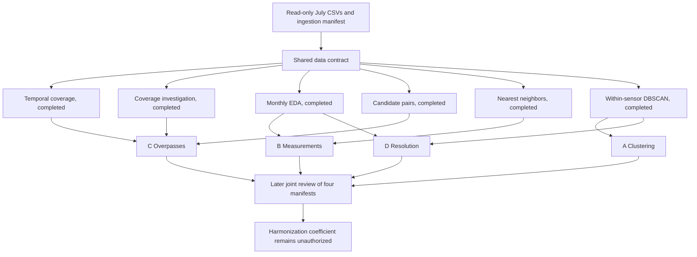

# Dependency graph

Experiments A, B, C, and D do not wait on each other. They read the same immutable July archives and they cite reports that are already finished. A later joint review can read all four manifests. That review is not part of this milestone, and it is not permission to calculate a harmonization coefficient.

There is no edge from A to B, from B to C, or between any other pair of experiments. An arrow into an experiment is a citation of a completed artifact. It is not a job that still has to be run.

## Independent tasks

These four tasks can run at the same time, including in four Git worktrees:

| Task | Reads | Does not need |
| --- | --- | --- |
| A. Clustering | Within-sensor report for the published settings. Representative-date rows only, unless a later configuration selects a full-month rebuild. | New outputs from B, C, or D |
| B. Measurements | Monthly EDA and the published positive-FRP ratios. One pass over satellite tables for new strata. | New outputs from A, C, or D |
| C. Overpasses | Temporal coverage, the coverage investigation, and the published time-separation bins. | New outputs from A, B, or D |
| D. Resolution | Published scan and track summaries and the existing degree grids. One pass for the `scan * track` distribution. | New outputs from A, B, or C. An H3 library. |

Preparation of the four run directories is also independent. The tests prepare all four under one temporary root and check that the directories differ.

## Shared prerequisites

Every experiment requires the same completed foundation:

- The four monthly CSVs, read-only, with the checksums and row counts in the schema.
- `reports/ingestion_2024_07.json`, with `processing_stream` null.
- The column contract and the July loader's `ObservationTable`.
- The sphere of radius 6,371,008.8 m, ECEF coordinates, and the great-circle length recovered from the chord.
- Native confidence, native brightness, and FRP retained with non-positive values.
- S-NPP dates 10–15 and 25–28 July left empty, and 16, 24, and 29 July left unrepaired.
- `same_fire` left `not_assessed`.

No experiment may rewrite those prerequisites.

## Potential conflicting assumptions

These are the places a later reading could mix two different definitions. The experiment that owns the definition is named so the others cite it instead of redefining it.

| Assumption that must stay distinct | Why it conflicts | Who owns it |
| --- | --- | --- |
| Terra and Aqua as separate satellites, versus the published pair label `MODIS (Terra and Aqua)` | Pooling them changes both the row count and the FRP distribution. | B reports them separately and keeps the published label when it cites a pair. A never pools them. |
| Time windows of 0, 30, and 180 minutes, versus 5, 15, 30, and 60 minutes, versus the 60-minute NOAA-20/NOAA-21 window | A 30-minute window is empty for NOAA-20 versus NOAA-21 because the overpasses are about 50 minutes apart. Using 30 minutes there would look like a spatial miss. | C owns the overpass interpretation. A and B state the window they use. |
| Positive-FRP ratios versus quantiles that keep zero and negative FRP | Dropping non-positive values from a distribution changes the median. Keeping them inside a ratio is undefined or misleading when the denominator is zero. | B uses quantiles with non-positive values retained, and ratios only when both values are positive. |
| A DBSCAN component, an equal-degree cell, and an H3 cell | Three different partitions of the same rows. None of them is a fire. | A owns components. D owns cells and does not select H3. |
| One radius for every sensor | MODIS same-day nearest medians are about 1.0–1.1 km. VIIRS medians are about 380 m. A 375 m neighborhood is almost empty for MODIS and is a real neighborhood for VIIRS. | A reports every setting per satellite. D describes the footprint difference. |
| The 2,250–2,500 m median separation bin inside 5 km | A 5 km disk has more area in the outer ring. The shared bin is not a characteristic fire size. | C and the candidate-pair report. D must not adopt 2.5 km as a footprint. |
| Cross-midnight margin rows | They let a window see the adjacent date. Counting them as a second date, or adding partition cluster counts, double-counts the boundary. | A reports margin-only neighbors and does not add partition counts into a monthly fire total. |
| Greedy one-to-one pairs as a calibration sample | The assignment walks dates in calendar order, so an earlier longer pair can block a later closer pair. The sample is not an unbiased matched set. | B may cite the published ratios and must not fit a coefficient to them. |
| FIRMS missing rows versus a Level-2 alert | The coverage investigation does not treat a Level-2 gap as proof that FIRMS was empty of fires, and it does not treat other sensors' rows as an S-NPP outage. | C keeps the two evidence classes separate. |
| NOAA-20 and NOAA-21 `fire_archive` filenames | The FIRMS readme does not define those standard products and says standard-quality data are not yet available. Version `2` is not a processing stream. | All four experiments leave `processing_level` unresolved. |
| Stored instrument `SNPP` versus the VIIRS family | Rewriting the column to `VIIRS` hides a real difference from NOAA-20 and NOAA-21, whose stored instrument is `VIIRS`. | The shared contract. Outputs echo `SNPP` when they echo the file. |
| Equal-degree counts as sampling weights | High-latitude cells are smaller, so a count overweight them relative to ground area. | D reports the spherical zone rate beside the count. |

## Integration requirements

A later milestone may read the four run manifests together only when every manifest still has:

- `same_fire` = `not_assessed`
- `missing_dates_filled` = false
- `harmonization_coefficient` = null
- `xgboost_trained` = false
- `processing_level` = `unresolved`
- `h3_selected` = false
- the same archive checksums as the ingestion manifest
- an output directory that stayed inside its own experiment id

That reading is a review of whether the four descriptions can be discussed in one place. It is not a merge of clusters into cells, and it is not a calibration. No integration job is defined or run here.

## What is not a dependency

- XGBoost, or any training set built from these pairs.
- A final MODIS-to-VIIRS scale factor.
- H3, or any other grid library.
- A repaired S-NPP file.
- A processing-level label for NOAA-20 or NOAA-21.
- The frontend globe. It does not read these experiments.
