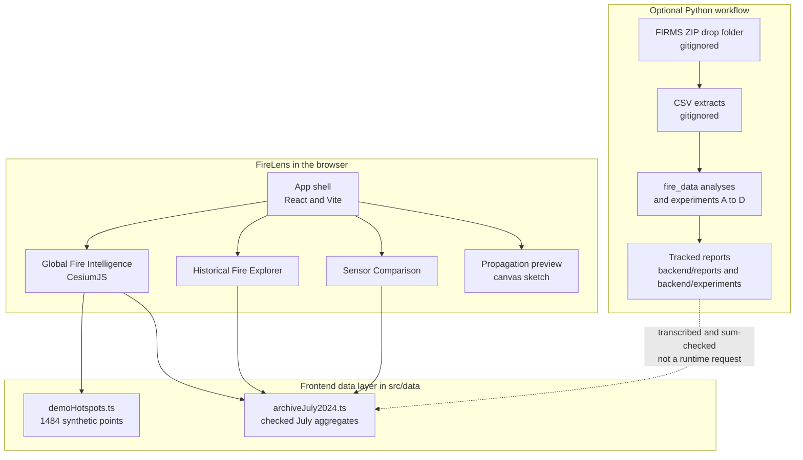

# FireLens architecture

This note describes the system as it exists in the repository. The website and the scientific pipeline are separate. They share numbers only where a TypeScript module transcribes a tracked report and checks the sums.

The scientific limits on those numbers are in [DATA_AND_LIMITATIONS.md](DATA_AND_LIMITATIONS.md). How to run the site is in the [README](../README.md).

## System diagram

There is no HTTP service between the browser and `backend/`. The dashed edge is a development step: a person copies published totals into `archiveJuly2024.ts`. The module then refuses to load if the daily series, the monthly portraits, or the 7 July total disagree.

The propagation screen does not read either data module. Its geometry comes from `src/features/spread/spreadModel.ts`.

## React and Vite frontend

The app is a single page. `index.html` mounts `src/main.tsx`, which renders `src/App.tsx` inside React Strict Mode. `App` returns `AppShell`.

`AppShell` (`src/features/shell/AppShell.tsx`) keeps the current screen and lazy-loads the other three on first visit:

| Screen id | Component | Navigation label |
| --- | --- | --- |
| `globe` | `src/features/globe/GlobeScreen.tsx` | Global |
| `history` | `src/features/history/HistoryScreen.tsx` | Historical |
| `sensors` | `src/features/compare/ComparisonScreen.tsx` | Sensors |
| `spread` | `src/features/spread/PropagationScreen.tsx` | Propagation |

The screen list and the short descriptions are `src/features/shell/nav.ts`. Each screen sits in an error boundary. A failed screen shows `ScreenFallback` and does not blank the shell.

Styling is Tailwind CSS 4, wired in `vite.config.ts` through `@tailwindcss/vite`. Shared controls live in `src/components/`: buttons, cards, badges, sensor toggles, and the historical trend chart.

Vite also publishes Cesium's workers, assets, widgets, and third-party files to `/cesiumStatic`, and it defines `CESIUM_BASE_URL` to that path. Production builds place the Cesium library in its own chunk. `npm run build` is `tsc -b` followed by `vite build`.

The browser does not import `backend/`. It does not fetch FIRMS, Earthdata, or a project API.

## CesiumJS globe

`CesiumGlobe` owns one Cesium `Viewer` for the life of the screen. `createGlobeViewer` chooses the basemap:

| `VITE_CESIUM_ION_TOKEN` | Imagery | Terrain |
| --- | --- | --- |
| Empty or unset | OpenStreetMap tiles, with the OSM copyright credit | WGS84 ellipsoid |
| Non-empty | Cesium ion default imagery | `Terrain.fromWorldTerrain()` |

The token is read in `src/config/cesium.ts` from `import.meta.env.VITE_CESIUM_ION_TOKEN`. An empty string is treated as absent. The legend calls `globeBasemapLabel()` so the active choice is visible.

Hotspots are a `PointPrimitiveCollection`. Color and pixel size come from the demo FRP bins in `src/data/hotspotStyle.ts`. A ring color is the platform color in `src/data/sensors.ts`. Picking a point uses a screen-space click handler and returns the demo id. The home view looks at longitude −48°, latitude 18°, from 18,500 km up.

The globe receives only the points that pass the current date, sensor, and day/night filters. Those filters apply to the synthetic sample. The archive block beside the map uses the same date and satellite selection against the July delivery table.

## Frontend data layer

| Module | Responsibility |
| --- | --- |
| `src/types/domain.ts` | Types for dates, sensors, demo hotspots, and daily deliveries. `HotspotSource` is `'demo'` or `'firms'`. Every current globe record is `'demo'`. |
| `src/data/demoHotspots.ts` | Deterministic sample. Seed `20240707`, dates 1–7 July 2024, 1,484 points. The module throws if the length falls outside 1,100–1,800, which is a render bound, not a scientific tolerance. |
| `src/data/archiveJuly2024.ts` | Daily delivered-row series, monthly portraits, and 7 July portraits. `verifyArchive()` checks 31 days per satellite, weekly sums, the 7,985,467 monthly total by satellite, and the 277,259 count on 7 July. |
| `src/data/queries.ts` | Filters demo points. Rolls up archive days. Builds the calendar and the trend series. Returns null for a date outside the loaded month instead of a zero. |
| `src/data/csv.ts` | Builds the historical export. A date with no loaded archive is a blank count and the status `archive_not_loaded`. |
| `src/data/sensors.ts` | MODIS, NOAA-20, NOAA-21, and Suomi-NPP metadata. MODIS expands to Terra and Aqua. |
| `src/data/format.ts` | Count, megawatt, coordinate, and confidence formatting. |
| `src/features/filters/dateRange.ts` | Inclusive ISO ranges, month bounds, and the 120-day chart cap. |

`DailyDelivery.deliveredRows` is `number | null`. Null means the CSV delivered no rows. The status string is `zero_rows_delivered` or `rows_delivered`. The historical screen's "no archive loaded" state is separate: it is a date outside July 2024, and the export leaves the count empty.

Suomi-NPP notes in the transcription follow the coverage investigation: 10–15 July and 25–28 July have no rows; 16, 24, and 29 July are marked partial; 25–28 July are not classed as a confirmed outage. NOAA-21 on 20 July keeps its 33,039 rows and a note about UTC hours 08–13.

## Python scientific pipeline

`backend/fire_data` is a library and a set of command-line modules. It is not a web server. Tests live in `backend/tests` and use pytest.

The one-day tools expect the 7 July sample described in [`backend/data/raw/README.md`](../backend/data/raw/README.md). The month tools expect `backend/data/raw/monthly_2024_07/`. Both trees are gitignored.

| Command | What it writes | Needs local CSVs |
| --- | --- | --- |
| `python -m fire_data discover` | `backend/reports/discovery.json` | 7 July sample |
| `python -m fire_data validate` | Exit status. Status 1 when the observed column contract fails. | 7 July sample |
| `python -m fire_data eda` | `eda_report.md`, `eda_summary.json`, `figures/` | 7 July sample |
| `python -m fire_data.investigate` | `anomaly_investigation.md`, `anomaly_summary.json` | 7 July sample |
| `python -m fire_data.temporal` | `temporal_validation.md` and related files | 7 July sample |
| `python -m fire_data.readiness` | `data_readiness.md`, `data_readiness.json` | 7 July sample |
| `python -m fire_data.ingest` | Monthly CSVs and `ingestion_2024_07.json` | Four July ZIPs |
| `python -m fire_data.monthly` | `temporal_coverage_2024_07.md`, `monthly_eda_2024_07.md`, and figures | Monthly CSVs |
| `python -m fire_data.spatiotemporal_analysis` | Candidate-pair report | Monthly CSVs |
| `python -m fire_data.nearest_neighbor_analysis` | Nearest-neighbor report | Monthly CSVs |
| `python -m fire_data.within_sensor_analysis` | Within-sensor report | Monthly CSVs |
| `python -m fire_data.experiments validate` | Schema check of an experiment JSON file | No |
| `python -m fire_data.experiments prepare` | An isolated run directory | No CSV read during prepare |
| `python -m fire_data.experiments execute` | Experiments A–D under `backend/experiments/` | Monthly CSVs |

Paths above are relative to a run from `backend/` with the virtualenv interpreter, matching [`backend/README.md`](../backend/README.md). The Suomi-NPP coverage note was written by `write_investigation()` in `fire_data.coverage_investigation`. That function is not registered as a `python -m` command. Re-running any archive command is optional. The committed reports are the review record.

Experiments A–D share one input contract: the July CSVs, read-only, 7,985,467 expected rows, and the four checksums in `backend/research/experiment_config.schema.json`. The schema rejects a configuration that fills a missing date, sets `same_fire` to anything other than `not_assessed`, stores a harmonization coefficient, or sets `xgboost_trained` to true. Completed outputs:

| Experiment | Question it records | Report |
| --- | --- | --- |
| A. Clustering | Stability of within-sensor components on one representative date per satellite | `backend/experiments/A_clustering/report.md` |
| B. Measurements | FRP, brightness, scan, track, confidence, and day/night, with every stored row kept | `backend/experiments/B_measurements/report.md` |
| C. Overpasses | Acquisition-minute gaps and which dates can be compared | `backend/experiments/C_overpasses/report.md` |
| D. Resolution | Stored scan and track, their product as a size proxy, and degree-cell counts | `backend/experiments/D_resolution/report.md` |

Distance math, where a report measures separation, uses a sphere of radius 6,371,008.8 m. A `cKDTree` searches chord length. The published separation is the great-circle length recovered from that chord. Search radii are not sensor footprints.

## FIRMS data ingestion

`fire_data.ingest` reads four unmodified ZIPs from `backend/data/incoming/2024-07/`. The product code in the ZIP name selects the destination:

| Code | Destination |
| --- | --- |
| `M-C61` | `monthly_2024_07/modis/` |
| `SV-C2` | `monthly_2024_07/viirs_snpp/` |
| `J1V-C2` | `monthly_2024_07/viirs_noaa20/` |
| `J2V-C2` | `monthly_2024_07/viirs_noaa21/` |

The filename is not used as a processing level. A dry run validates and writes nothing. A full run extracts one CSV per sensor, writes `backend/reports/ingestion_2024_07.json`, and does not overwrite an existing extract. It does not write into the 7 July sample directories (`modis/`, `viirs_snpp/`, `viirs_noaa20/`, `viirs_noaa21/` directly under `data/raw/`).

A date with no stored row is absent from that CSV. Ingestion does not insert a zero-detection placeholder.

The July order that the reports describe used these files:

| ZIP | Extract |
| --- | --- |
| `DL_FIRE_M-C61_850319.zip` | `fire_archive_M-C61_850319.csv` |
| `DL_FIRE_SV-C2_850322.zip` | `fire_archive_SV-C2_850322.csv` |
| `DL_FIRE_J1V-C2_850320.zip` | `fire_archive_J1V-C2_850320.csv` |
| `DL_FIRE_J2V-C2_850321.zip` | `fire_archive_J2V-C2_850321.csv` |

Those bytes are local. Git ignores `backend/data/raw/**/*.csv`, the ZIPs, and `backend/data/incoming/**/*.zip`. A clone contains the reports and the empty-directory notes, not the archives. See [`backend/data/raw/monthly_2024_07/README.md`](../backend/data/raw/monthly_2024_07/README.md).

The 7 July sample is an earlier download, request ids 850118–850121. The monthly exploratory report cross-checks 7 July inside the monthly CSVs against that sample and records a difference of zero for Terra, Aqua, NOAA-20, NOAA-21, and Suomi-NPP.

## Existing reports and provenance

Tracked reports are the scientific record a reviewer can read without the CSVs. Figures under `backend/reports/figures/` belong to those reports.

**One day, 7 July 2024**

| Report | Subject |
| --- | --- |
| `backend/reports/discovery.json` | Measured archives |
| `backend/reports/eda_report.md` | 277,259 detections. Counts, FRP, confidence, scan, track, day/night |
| `backend/reports/anomaly_investigation.md` | VIIRS 367 K and two Aqua FRP rows |
| `backend/reports/temporal_validation.md` | Single-date provenance and proximity audit |
| `backend/reports/data_readiness.md` | Field-by-field provenance matrix |
| `backend/reports/viirs_thermal_field_mapping_2024_07_07.md` | Column names compared with FIRMS and the user's guide |
| `backend/reports/firms_api_provenance_2024_07_07.md` | Unsent area-API check |

**Full month**

| Report | Subject |
| --- | --- |
| `backend/reports/ingestion_2024_07.json` | Ingestion manifest |
| `backend/reports/temporal_coverage_2024_07.md` | Daily matrix, checksums, duplicate keys |
| `backend/reports/monthly_eda_2024_07.md` | Month-long FRP, confidence, brightness, day/night |
| `backend/reports/coverage_investigation_2024_07.md` | Suomi-NPP gaps against LP DAAC alerts and CMR metadata |
| `backend/reports/spatiotemporal_analysis_2024_07.md` | Candidate pairs |
| `backend/reports/nearest_neighbor_analysis_2024_07.md` | Directed, mutual, and one-to-one neighbors |
| `backend/reports/within_sensor_analysis_2024_07.md` | Same-satellite neighbors and DBSCAN components |
| `backend/reports/firms_reacquisition_2024_07.md` | Reacquisition notes |

**Design, not a new dataset**

| Document | Subject |
| --- | --- |
| `backend/research/SHARED_DATA_CONTRACT.md` | Definitions the experiments are required to keep |
| `backend/research/EXPERIMENT_DESIGN.md` and `EXPERIMENT_MATRIX.md` | What A–D may and may not conclude |
| `backend/research/HISTORICAL_DATA_STRATEGY.md` | How a later multi-year series would be separated by product |
| `backend/research/ACQUISITION_PLAN.md` | An order that was not submitted |
| `backend/research/VALIDATION_SAMPLING_STRATEGY.md` | A calendar that excludes July 2024 |

Provenance rules that every one of those documents is written to obey:

- An observation is one stored CSV row. Counting observations counts rows.
- `processing_stream` stays null unless a provider field names it. `fire_archive`, `fire_nrt`, `2`, and `61.03` do not assign a stream.
- A date with no row is left out. It is not stored as zero fire activity.
- `same_fire` stays `not_assessed`.
- No harmonization coefficient is written.
- XGBoost is not trained.

## Real aggregates and synthetic map points

The split is the main architectural constraint.

**Real aggregates.** `archiveJuly2024.ts` stores counts and summary statistics that appear in `temporal_coverage_2024_07.md`, `monthly_eda_2024_07.md`, and `eda_report.md`. The historical explorer, the sensor comparison, and the globe's archive panel read this module. They never open a CSV. The export CSV is this table, not the FIRMS files.

**Synthetic map points.** `demoHotspots.ts` builds 1,484 records for 1–7 July 2024. The file header states that the positions are illustrative clusters, not the archived coordinates. Each record has `source: 'demo'`. The globe draws only these records. A July date after 7 July shows an empty map and still shows the archive counts in the side panel.

The two collections answer different questions. The archive panel answers "how many rows did the file deliver?" The globe answers "what does a labeled multi-sensor map look like?" Using one number to stand for the other would erase the difference the project exists to explain.

Replacing the globe sample means substituting parsed FIRMS rows and setting `source` to `'firms'` on those rows. The module comment forbids appending real rows onto the demo array without that label. That replacement has not been done.
